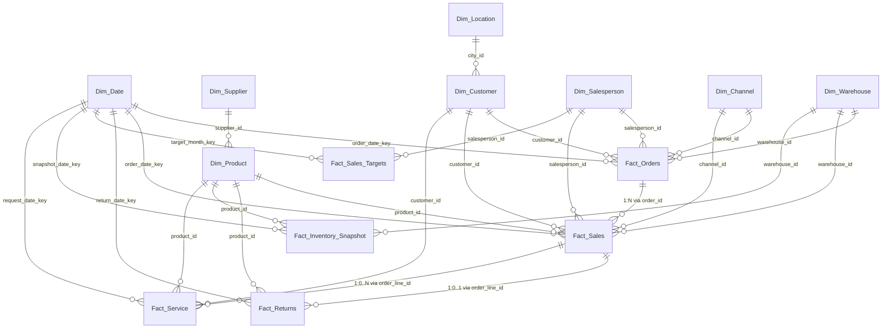

# Dimensional Data Model — DentaKart Analytics (5M Scale)

## 1. Dimensional Architecture & Star Schema Design
The DentaKart enterprise model follows Kimball Dimensional Modeling principles with conformed dimensions and multiple transaction and periodic snapshot facts.

### Star Schema Entity-Relationship Diagram (Mermaid)



---

## 2. Table Granularities, Keys & Volume Matrix

| Table | Exact Business Grain | Primary Key | Foreign Keys & Unique Constraints | Expected Rows | Mathematical Derivation |
|---|---|---|---|---|---|
| **`Fact_Sales`** | 1 row per **Order Line Item** | `order_line_id` (BIGINT) | FK: `order_id`, `order_date_key`, `customer_id`, `product_id`, `salesperson_id`, `warehouse_id`, `channel_id` | **~5,000,000** | $\sim 1,250,000 \text{ orders} \times 4.0 \text{ lines/order}$ |
| **`Fact_Orders`** | 1 row per **Order Header** | `order_id` (INT) | FK: `order_date_key`, `customer_id`, `channel_id`, `salesperson_id`, `warehouse_id` | **~1,250,000** | Event-driven order placements |
| **`Fact_Returns`** | 1 row per **Return Line Event** | `return_id` (INT) | FK: `order_line_id`, `order_id`, `return_date_key`, `product_id` | **~220,000** | $\sim 4.4\% \text{ of delivered sales lines}$ |
| **`Fact_Sales_Targets`** | 1 row per **Month × Region × Rep × Category** | `target_id` (INT) | UQ: `(target_month_key, region, salesperson_id, target_category)`<br>FK: `target_month_key`, `salesperson_id` | **120,000** | $60 \text{ months} \times 500 \text{ reps} \times 4 \text{ target categories}$ |
| **`Fact_Inventory_Snapshot`** | 1 row per **Product × Warehouse × Month-End** | `snapshot_id` (BIGINT) | UQ: `(snapshot_date_key, product_id, warehouse_id)`<br>FK: `snapshot_date_key`, `product_id`, `warehouse_id` | **360,000** | $1,000 \text{ products} \times 6 \text{ warehouses} \times 60 \text{ months}$ |
| **`Fact_Service`** | 1 row per **Service / Warranty Ticket** | `service_ticket_id` (INT) | FK: `order_line_id`, `product_id`, `customer_id`, `request_date_key`, `resolved_date_key` | **~120,000** | $\sim 12\% \text{ ticket rate on capital equipment}$ |

---

## 3. Explicit Region Architecture: Sales Territory vs Customer Geography

To prevent analytical ambiguity and enable sophisticated enterprise territory analytics, the data warehouse explicitly separates the two region hierarchies:

```
+---------------------------------------------------------------------------------------------------------+
| REGION HIERARCHY ARCHITECTURE                                                                           |
+--------------------------+-------------------------------+----------------------------------------------+
| Dimension Attribute      | Business Meaning              | Analytical Purpose                           |
+--------------------------+-------------------------------+----------------------------------------------+
| Dim_Salesperson.         | Sales Territory Region        | Defines commercial territory quotas in       |
| sales_territory_region   | (Rep Assigned Territory)      | Fact_Sales_Targets. Controls quota payout.   |
+--------------------------+-------------------------------+----------------------------------------------+
| Dim_Location.            | Customer Geographic Region    | Defines physical clinic / hospital location. |
| customer_geographic_     | (Physical Clinic Location)    | Slices regional demand and logistics freight.|
| region                   |                               |                                              |
+--------------------------+-------------------------------+----------------------------------------------+
```

### Business Scenarios Enabled by Dual Region Architecture:
1. **Sales Territory Quota Performance**:
   - `Fact_Sales` performance region is derived from `Dim_Salesperson.sales_territory_region`.
   - Compares the rep's actual booked revenue against `Fact_Sales_Targets.region`.
2. **Customer Geographic Healthcare Slicing**:
   - Analyzes clinical consumable consumption based on `Dim_Location.customer_geographic_region`.
3. **Cross-Territory Sales Leakage Analysis**:
   - Measures instances where a sales representative assigned to `West` (e.g. Mumbai) closes a deal with an institutional dental college chain located in `North` (e.g. Delhi-NCR).
   - In SQL/Tableau, comparing `Dim_Salesperson.sales_territory_region <> Dim_Location.customer_geographic_region` isolates cross-territory transactions.

---

## 4. `Fact_Sales_Targets` Grain, Target Categories & Anti-Fan-Out SQL Pattern

### The 4 Target-Bearing Focus Categories
To replicate real-world commercial operations, DentaKart sets structured sales quotas only on its **4 Core Strategic Revenue Divisions**:
1. **`Dental Capital Equipment`**: High-ticket chairs, compressors, suction units.
2. **`Dental Clinical Consumables`**: High-frequency recurring consumables and biomaterials.
3. **`Digital Imaging & Radiology`**: High-margin digital RVG sensors, 3D scanners, OPG/CBCT.
4. **`Sterilization & Infection Control`**: Mandatory autoclave and disinfection systems.

*Untargeted Product Sales*: Handpieces, instruments, dental laboratory bench gear, and educational models exist in `Dim_Product` and generate revenue in `Fact_Sales`, but carry zero rows in `Fact_Sales_Targets`. In Tableau/SQL, an outer join gracefully surfaces these as untargeted actuals.

### Safe Actual vs Target SQL Query (Using Sales Territory Region)
```sql
WITH MonthlyActuals AS (
    SELECT 
        D.year * 10000 + D.month_number * 100 + 1 AS target_month_key,
        SP.sales_territory_region AS region,
        S.salesperson_id,
        P.target_category,
        SUM(S.net_sales_inr) AS actual_sales_inr,
        SUM(S.gross_profit_inr) AS actual_gross_profit_inr
    FROM Fact_Sales S
    JOIN Dim_Date D ON S.order_date_key = D.date_key
    JOIN Dim_Product P ON S.product_id = P.product_id
    JOIN Dim_Salesperson SP ON S.salesperson_id = SP.salesperson_id
    WHERE P.target_category IN (
        'Dental Capital Equipment',
        'Dental Clinical Consumables',
        'Digital Imaging & Radiology',
        'Sterilization & Infection Control'
    )
    GROUP BY 
        D.year * 10000 + D.month_number * 100 + 1,
        SP.sales_territory_region,
        S.salesperson_id,
        P.target_category
)
SELECT 
    T.target_month_key,
    T.region,
    T.salesperson_id,
    T.target_category,
    COALESCE(A.actual_sales_inr, 0) AS actual_sales_inr,
    T.target_sales_inr,
    (COALESCE(A.actual_sales_inr, 0) - T.target_sales_inr) AS variance_inr,
    (COALESCE(A.actual_sales_inr, 0) / NULLIF(T.target_sales_inr, 0)) * 100 AS achievement_pct
FROM Fact_Sales_Targets T
LEFT JOIN MonthlyActuals A 
    ON T.target_month_key = A.target_month_key
   AND T.region = A.region
   AND T.salesperson_id = A.salesperson_id
   AND T.target_category = A.target_category;
```

---

## 5. Fact-to-Fact Relationship Strategy & Anti-Fan-Out Matrix

```
+---------------------------------------------------------------------------------------------------+
| FACT-TO-FACT INTERACTION & ANTI-FAN-OUT MATRIX                                                    |
+--------------------------+---------------------+-------------------+------------------------------+
| Relationship Pair        | Relationship Nature | Grain Difference  | Direct Physical Join Allowed?|
+--------------------------+---------------------+-------------------+------------------------------+
| Fact_Orders -> Sales     | 1 : Many (1:N)      | Header to Lines   | CONDITIONAL (Avoid Header SUM)|
| Fact_Sales -> Returns    | 1 : 0..1 (or 1:N)   | Sold Line to Ret  | STRICTLY ON order_line_id    |
| Fact_Sales -> Service    | 1 : 0..N            | Line to Tickets   | FORBIDDEN FOR SALES REPORTING|
| Fact_Sales -> Targets    | Many : Many (M:N)   | Line to Quota     | STRICTLY FORBIDDEN           |
| Fact_Sales -> Inventory  | Many : Many (M:N)   | Line to Snapshot  | STRICTLY FORBIDDEN           |
+--------------------------+---------------------+-------------------+------------------------------+
```

### Intentional Interview Scenarios:
1. **"Why did my sales amount double after joining returns?"**
   - *Root Cause*: Joining on `order_id` instead of `order_line_id`, or multiple partial return inspections creating duplicate rows for a single sold line.
   - *Tableau Solution*: Maintain separate tables in the Logical Layer related on `order_line_id` and compute Return Rate % as `SUM([Fact_Returns].[returned_quantity]) / SUM([Fact_Sales].[quantity])`.
2. **"Why did my target duplicate?"**
   - *Root Cause*: Direct physical join between `Fact_Sales` (5M rows) and `Fact_Sales_Targets` (120k rows) on `salesperson_id`. Each order line multiplies the salesperson's monthly quota.
   - *Tableau Solution*: Connect both fact tables to conformed dimensions (`Dim_Salesperson`, `Dim_Date`) in Tableau's Logical Layer (Relationships).
3. **"How do you model multiple fact tables with different grains?"**
   - *Senior Answer*: Never join disparate facts into a wide physical table. In SQL, pre-aggregate to a common grain before joining. In Tableau, relate facts through shared conformed dimensions in the Logical Layer.
